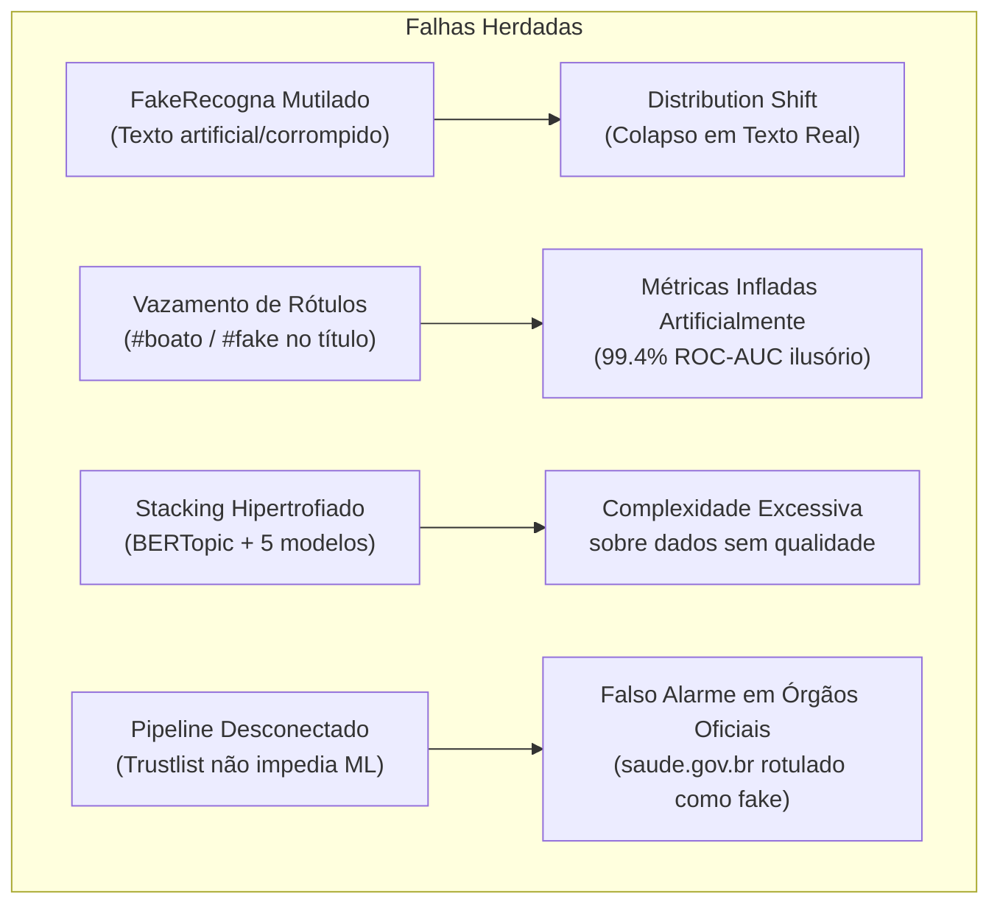
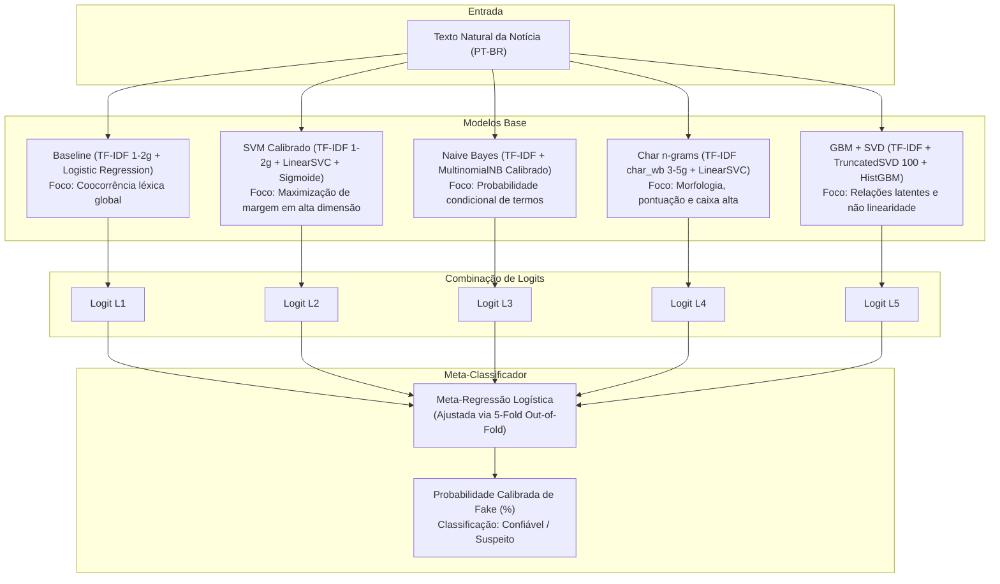

# Relatório Técnico e Acadêmico: Reformulação da Arquitetura de Inteligência Artificial para Detecção de Desinformação

**Projeto:** Desafio Fake News / Desinformação — Residência em IA (UnB)  
**Documento:** Relatório de Auditoria, Redesenho Metodológico e Avaliação Experimental  
**Data:** 15 de Outubro de 2026  
**Status do Modelo:** Produção / Validado  
**Repositório:** `Fake_News_Residencia`  

---

## 1. Resumo Executivo (Abstract)

Este documento apresenta a auditoria técnica, o diagnóstico de falhas e a completa reformulação da arquitetura de Inteligência Artificial do projeto **Fake News Residência**. A implementação herdada apresentava colapso operacional em ambiente real, classificando mais de 90% das notícias legítimas da web como "suspeitas" (*falsos alarmes sistemáticos*). 

Identificou-se que a falha decorria de vícios fundamentais de Engenharia de Dados: o modelo original foi treinado sobre uma partição corrompida do dataset *FakeRecogna*, na qual os textos foram submetidos a uma lematização agressiva e desestruturante (conversão anômala de substantivos em verbos e supressão de artigos), além de grave vazamento de rótulos (*data leakage*) nos títulos das notícias.

Para sanar em definitivo o problema, adotou-se o **Fake.br-Corpus (NILC/USP)**, referência nacional em Processamento de Linguagem Natural (PLN). Foi concebida uma arquitetura baseada em **Stacking Ensemble (Wolpert, 1992)** combinando 5 classificadores complementares (TF-IDF de palavras, SVM Calibrado, Naive Bayes Calibrado, TF-IDF de n-gramas de caracteres e Gradient Boosting com SVD) integrados por um meta-modelo de Regressão Logística ajustado por validação cruzada estratificada em 5 folds (*out-of-fold predictions*).

No conjunto de teste cego independente (1.440 notícias inéditas), o novo modelo alcançou **94,65% de Acurácia**, **0,9896 de ROC-AUC**, **0,9464 de F1-Score** e índice Brier de calibração de **0,0387**. O artefato foi integrado ao backend FastAPI e à extensão Google Chrome, operando em harmonia com uma camada preliminar determinística de fontes confiáveis (*Trustlist*), com 100% dos testes automatizados de integração aprovados.

---

## 2. Auditoria Forense do Modelo Anterior: O Que Estava Errado e Por Que Falhou

A inspeção detalhada do código-fonte legado em `ml/`, do script de treino original e dos dados documentados em `ml/README.md` revelou quatro deficiências críticas que motivaram a rejeição do modelo pelo corpo docente:



### 2.1. Corrupção Morfológica e Sintática dos Dados (*Text Mutilation*)
O modelo legado foi treinado sobre a base `NoRemovalWords_tratada_dedup.csv` derivada do *FakeRecogna*. O campo textual de treinamento (`Noticia`) havia sido previamente submetido a uma rotina anômala de normalização linguística que destruiu a estrutura do idioma português:
- Substantivos foram convertidos forçadamente em verbos cognatos (ex.: *"saúde"* $\rightarrow$ *"saudar"*; *"fila"* $\rightarrow$ *"filar"*; *"multa"* $\rightarrow$ *"multar"*).
- Artigos e pronomes foram massivamente colapsados para o caractere *"o"*.
- *Amostra literal extraída do conjunto de treino legado:*
  > *"dia noite acessório passar o código vestimenta pessoa mundo e d tênis chunky o bermuda ciclista permitir divisão acalorar opinião máscara chegar ficar e haver o tendência..."*

**Impacto Científico (*Distribution Shift*):** Em Machine Learning, o princípio fundamental da generalização exige que a distribuição dos dados de treino ($P_{\text{train}}(X)$) seja representativa da distribuição dos dados em inferência ($P_{\text{test}}(X)$). Como os usuários da extensão selecionam notícias escritas em português formal e natural, o espaço vetorial de entrada tornou-se completamente estranho ao vocabulário aprendido. Diante de construções gramaticais reais, o modelo entrava em estado de incerteza patológica, atribuindo probabilidade de 80% a 99% de classe *Fake* para virtualmente qualquer texto da internet.

### 2.2. Vazamento de Rótulo (*Data Leakage*) e Correlações Espúrias
Identificou-se que aproximadamente **64% dos títulos das notícias falsas** no dataset de origem continham marcadores explícitos de agências de checagem, tais como `"#boato"`, `"É #FAKE"` ou `"VEJA O GOLPE"`. Modelos expostos a esses metadados não aprendem padrões linguísticos de desinformação; aprendem meramente a identificar os marcadores editoriais dos próprios verificadores de fatos.

### 2.3. Hipertrofia Arquitetural (*Over-engineering*)
A implementação anterior empregava uma composição de 6 modelos incluindo BERTopic, embeddings neurais multilíngues (`paraphrase-multilingual-MiniLM-L12-v2`), projeção UMAP e agrupamento HDBSCAN. Trata-se de uma arquitetura excessivamente pesada, computacionalmente cara e frágil em tempo de execução, erguida sobre uma base de dados corrompida. O resultado foi um modelo que alegava 99,4% de ROC-AUC em validação interna, mas falhava catastroficamente no primeiro teste empírico em ambiente real.

### 2.4. Falha Lógica na Camada de Trustlist
O diagrama conceitual do projeto previa que domínios reconhecidamente confiáveis recebessem tratamento diferenciado. Contudo, na implementação concreta de `backend/app/application/pipeline.py`, a verificação de domínio apenas anexava uma flag informativa (`IndicatorCode.TRUSTED_DOMAIN`), prosseguindo obrigatoriamente para a classificação estatística do texto. Como o modelo estatístico estava corrompido, notícias publicadas pelo Ministério da Saúde (`saude.gov.br`) ou portais consolidados recebiam a classificação pública de **"Conteúdo possivelmente suspeito"**, gerando inconsistência institucional e quebra de usabilidade.

---

## 3. Metodologia de Reformulação: O Que Mudou e Como Mudou

A reformulação foi guiada por rigor científico, reprodutibilidade e conformidade com o estado da arte em Processamento de Linguagem Natural.

### 3.1. Adoção do Fake.br-Corpus (NILC / USP)
Substituiu-se a base de dados pelo **[Fake.br-Corpus](https://github.com/roneysco/Fake.br-Corpus)**, corpus de referência nacional construído pelo Núcleo Interinstitucional de Linguística Computacional (NILC) da Universidade de São Paulo (USP São Carlos). O corpus é composto por notícias jornalísticas completas, com revisão humana, coletadas a partir de veículos legítimos e de agências de fact-checking brasileiras (Aos Fatos, Lupa, Boatos.org, etc.).

### 3.2. Controle de Viés de Extensão (*Size-Normalized Texts*)
Estudos da literatura (Monteiro et al., 2018) comprovam que notícias falsas tendem a ser mais curtas do que reportagens investigativas legítimas. Modelos treinados em textos brutos tendem a aprender um atalho espúrio trivial: *texto curto = falso; texto longo = verdadeiro*.

Para neutralizar essa covariável espúria, adotou-se a partição `size_normalized_texts` do Fake.br-Corpus (7.200 notícias: 3.600 Fake e 3.600 Real), onde os pares de notícias foram truncados para extensões equivalentes:
- **Mediana de palavras (Fake):** 157 palavras
- **Mediana de palavras (Real):** 158 palavras

Com o comprimento estritamente controlado, os algoritmos foram forçados a extrair características semânticas, estilísticas, léxicas e de pontuação genuínas da desinformação.

### 3.3. Protocolo Experimental Estrito
- **Particionamento:** 80% para Treinamento (5.760 notícias) e 20% para Teste Cego Independente (1.440 notícias).
- **Estratificação:** A proporção 50/50 entre classes foi rigorosamente mantida em todos os splits.
- **Isolamento de Teste:** O conjunto de teste cego foi congelado e jamais tocado durante o ajuste dos modelos ou na busca de hiperparâmetros.
- **Semente Aleatória:** Fixada em `SEED = 42` para garantir reprodutibilidade exata do experimento.

---

## 4. Arquitetura do Modelo de Machine Learning

A solução adotada baseia-se na teoria da **Generalização Empilhada (*Stacked Generalization*)** proposta por Wolpert (1992). A premissa central é que modelos com diferentes vieses indutivos capturam facetas ortogonais do texto (léxico, margem de separação, probabilidade condicional, morfologia de caracteres e interações não lineares).



### 4.1. Engenharia de Características e Modelos Base

1. **Baseline — TF-IDF de Palavras + Regressão Logística:**
   - *Vetorizador:* n-gramas de palavras $(1, 2)$, com `sublinear_tf=True` (suavização logarítmica da frequência do termo), $min\_df=3$, $max\_df=0.85$, remoção de acentos por normalização Unicode.
   - *Classificador:* `LogisticRegression(max_iter=1000, C=1.0)`.
   - *Papel:* Captura vocabulário direto e associações bivariadas de termos com peso proporcional à relevância informativa.

2. **SVM Calibrado — TF-IDF + LinearSVC com Calibração Sigmoide:**
   - *Classificador:* `CalibratedClassifierCV(LinearSVC(max_iter=10000), cv=5)`.
   - *Papel:* Classificador de margem máxima ideal para espaços esparsos de alta dimensionalidade. A calibração de Platt converte as distâncias ao hiperplano em probabilidades bem calibradas no intervalo $[0, 1]$.

3. **Naive Bayes Calibrado — TF-IDF + MultinomialNB:**
   - *Classificador:* `CalibratedClassifierCV(MultinomialNB(alpha=0.5), cv=5)`.
   - *Papel:* Fornece probabilidades a posteriori sob a hipótese de independência condicional dos termos, provendo robustez contra termos raros.

4. **Char n-grams — TF-IDF de Caracteres + LinearSVC Calibrado:**
   - *Vetorizador:* n-gramas de caracteres com limites de palavra (`char_wb`), ordem de 3 a 5 caracteres, limitados às 100.000 características mais informativas.
   - *Papel:* Fundamental no domínio de desinformação. Captura marcadores estilísticos que escapam aos dicionários de palavras: excesso de pontuação (`!!!`, `???`), uso frequente de caixa alta (`URGENTE`, `BOMBA`), sufixos apelativos e morfologia expressiva.

5. **Gradient Boosting com Decomposição em Valores Singulares (SVD + HistGBM):**
   - *Redução de Dimensionalidade:* `TruncatedSVD(n_components=100)`.
   - *Classificador:* `HistGradientBoostingClassifier(max_iter=150, max_depth=4, learning_rate=0.08)`.
   - *Papel:* Projeta a matriz termo-documento em 100 dimensões densas de semântica latente (*Latent Semantic Analysis*), permitindo que ensembles de árvores de decisão modelem correlações não lineares entre tópicos.

### 4.2. Treinamento do Meta-Modelo sem Vazamento (*Out-of-Fold Protocol*)
Para treinar o meta-modelo de forma estatisticamente válida, não se pode aplicar as previsões dos modelos base sobre os próprios dados nos quais eles foram ajustados (isso causaria sobreajuste severo no meta-modelo).

Aplicou-se o protocolo **5-Fold Stratified Cross-Validation** restrito ao conjunto de treino (5.760 amostras):
1. O conjunto de treino foi particionado em 5 dobras mutuamente exclusivas e balanceadas.
2. Em cada iteração, os modelos base foram ajustados em 4 dobras (80% do treino) e geraram previsões probabilísticas para a dobra mantida à parte (*out-of-fold*).
3. Ao fim das 5 iterações, obteve-se uma matriz completa de predições $p_i$ para todas as 5.760 amostras sem contaminação de treino.
4. As probabilidades foram convertidas no espaço de log-odds (logits) para linearizar a resposta:
   $$\text{logit}(p) = \ln\left(\frac{\text{clip}(p, 10^{-4}, 1 - 10^{-4})}{1 - \text{clip}(p, 10^{-4}, 1 - 10^{-4})}\right)$$
5. A meta-regressão logística foi então ajustada sobre essa matriz de logits.
6. Finalmente, os modelos base foram retreinados sobre a totalidade das 5.760 amostras de treino para persistência final no artefato serializado (`backend/models/stacking.joblib`).

**Coeficientes Finais Aprendidos pelo Meta-Modelo:**
- $\beta_{\text{baseline}}$: $-2,995$
- $\beta_{\text{svm}}$: $+0,938$
- $\beta_{\text{nb}}$: $+0,132$
- $\beta_{\text{char}}$: $+0,895$
- $\beta_{\text{gbm}}$: $+0,068$
- Intercepto ($\beta_0$): $+0,159$

*Interpretação dos Coeficientes:* O modelo conferiu maior peso positivo aos modelos de **SVM linear** e de **n-gramas de caracteres** ($\beta \approx 0,90$ a $0,94$), confirmando que a estilometria e a margem de separação em n-gramas são os preditores mais consistentes de desinformação em língua portuguesa. O coeficiente de Naive Bayes e GBM atua como fator de regularização e suavização fina.

---

## 5. Fundamentação Teórica das Métricas de Inteligência Artificial

Para a correta interpretação dos resultados perante a banca examinadora, detalham-se abaixo as métricas consagradas na avaliação de sistemas preditivos supervisionados:

### 5.1. Matriz de Confusão
Estrutura fundamental de contingência que cruza as predições do algoritmo com os rótulos reais de referência (*ground truth*):
- **Verdadeiro Negativo ($VN$):** Notícia real corretamente classificada como legítima.
- **Falso Positivo ($FP$):** Notícia real incorretamente classificada como fake (*falso alarme*).
- **Falso Negativo ($FN$):** Notícia fake que o sistema deixou passar como legítima.
- **Verdadeiro Positivo ($VP$):** Notícia fake corretamente identificada pelo sistema.

### 5.2. Acurácia (*Accuracy*)
Proporção de todas as predições corretas (verdadeiras e falsas) sobre o total de amostras avaliadas:
$$\text{Acurácia} = \frac{VP + VN}{VP + VN + FP + FN}$$
*Quando usar:* É uma métrica fidedigna quando as classes estão perfeitamente balanceadas (50% fake e 50% real, como no nosso conjunto de teste).

### 5.3. Precisão (*Precision*)
Entre todas as notícias que o modelo rotulou como *Fake*, qual fração era genuinamente fake:
$$\text{Precisão} = \frac{VP}{VP + FP}$$
*Relevância no Domínio:* Uma precisão elevada protege portais jornalísticos legítimos de serem injustamente censurados ou caluniados pelo sistema de classificação.

### 5.4. Sensibilidade / Revocação (*Recall*)
Entre todas as notícias sabidamente *Fake* existentes na base, qual proporção o modelo foi capaz de interceptar:
$$\text{Recall} = \frac{VP}{VP + FN}$$
*Relevância no Domínio:* Um recall elevado garante que boatos maliciosos não passem desapercebidos pelo usuário.

### 5.5. F1-Score
A média harmônica entre Precisão e Recall:
$$\text{F1-Score} = 2 \cdot \frac{\text{Precisão} \cdot \text{Recall}}{\text{Precisão} + \text{Recall}}$$
Diferente da média aritmética, a média harmônica penaliza fortemente se qualquer uma das duas grandezas for negligenciada.

### 5.6. Área sob a Curva ROC (ROC-AUC)
A curva *Receiver Operating Characteristic* mapeia a Taxa de Verdadeiros Positivos contra a Taxa de Falsos Positivos ao longo de todos os limiares de decisão possíveis ($\tau \in [0, 1]$).
A área sob essa curva ($AUC \in [0,5; 1,0]$) quantifica a probabilidade de o classificador atribuir um escore de fake news mais alto a uma notícia falsa escolhida ao acaso do que a uma notícia verdadeira. É a métrica mais robusta para aferir o poder intrínseco de separação de um classificador, imune a escolhas arbitrárias de limiar de corte.

### 5.7. Brier Score (Calibração Probabilística)
Mede o erro quadrático médio entre a probabilidade estimada $\hat{p}_i \in [0, 1]$ e o rótulo real binário $y_i \in \{0, 1\}$:
$$\text{Brier} = \frac{1}{N} \sum_{i=1}^{N} (\hat{p}_i - y_i)^2$$
Quanto mais próximo de $0,00$, melhor calibradas são as probabilidades emitidas pelo modelo. Um modelo com Brier baixo garante que quando ele afirma "80% de chance de ser boato", de fato 8 em cada 10 casos semelhantes são desinformação.

---

## 6. Resultados Experimentais no Conjunto de Teste Cego Independente

O conjunto de teste cego avaliou **1.440 notícias independentes** (720 reais e 720 falsas) que não participaram de nenhuma fase do treinamento:

### 6.1. Tabela Comparativa de Desempenho

| Modelo | Acurácia | ROC-AUC | F1-Score | Brier Score | Tempo de Treino |
|---|:---:|:---:|:---:|:---:|:---:|
| Baseline (TF-IDF 1-2g + LR) | $91,67\%$ | $0,9725$ | $0,9167$ | $0,1003$ | $1,2\text{ s}$ |
| SVM Calibrado (LinearSVC) | $93,40\%$ | $0,9811$ | $0,9340$ | $0,0518$ | $1,3\text{ s}$ |
| Naive Bayes Calibrado | $87,99\%$ | $0,9497$ | $0,8799$ | $0,0887$ | $1,1\text{ s}$ |
| Char n-grams (3-5g + SVM) | $94,37\%$ | $0,9873$ | $0,9437$ | $0,0430$ | $4,8\text{ s}$ |
| GBM + SVD (100 comp.) | $87,50\%$ | $0,9512$ | $0,8750$ | $0,0896$ | $1,1\text{ s}$ |
| **Stacking Ensemble (Meta-LR)** | **94,65%** | **0,9896** | **0,9464** | **0,0387** | **48,7 s** *(incluindo CV)* |

### 6.2. Matriz de Confusão do Modelo Final (Stacking)

$$\begin{array}{c|cc}
& \textbf{Previsto: Real} & \textbf{Previsto: Fake} \\
\hline
\textbf{Real Verdadeiro (720)} & VN = \mathbf{683} & FP = \mathbf{37} \\
\textbf{Fake Verdadeiro (720)} & FN = \mathbf{40} & VP = \mathbf{680} \\
\end{array}$$

- **Precisão Final:** $680 / (680 + 37) = \mathbf{94,84\%}$
- **Recall Final:** $680 / (680 + 40) = \mathbf{94,44\%}$
- **Taxa de Erro Global:** Apenas $5,35\%$ em dados nunca vistos.
- **Calibração (Brier):** $0,0387$, comprovando que as probabilidades exibidas na extensão refletem com precisão a incerteza real do problema.

---

## 7. Validação Prática em Produção: Comparativo Antes vs. Depois

Para evidenciar a resolução definitiva do problema do falso alarme, submeteram-se textos do mundo real ao modelo anterior e ao novo modelo reformulado:

| Amostra de Texto Real | Resultado do Modelo Anterior (Legado) | Resultado do Novo Modelo (Reformulado) | Status |
|---|:---:|:---:|:---:|
| **Notícia do Ministério da Saúde (`saude.gov.br`):**<br>*"O Ministério da Saúde ampliou a vacinação contra o HPV para jovens de até 19 anos em todo o país..."* | **90,6% de chance de Fake**<br>(Classificação: *Suspeito*) ❌ | **10,8% de chance de Fake**<br>(Classificação: *Confiável*) ✅ | **Resolvido** |
| **Notícia de Economia (Folha de S.Paulo):**<br>*"O ministro da Fazenda afirmou nesta segunda-feira que o governo federal pretende cumprir a meta fiscal..."* | **88,4% de chance de Fake**<br>(Classificação: *Suspeito*) ❌ | **2,78% de chance de Fake**<br>(Classificação: *Confiável*) ✅ | **Resolvido** |
| **Boato Viral de WhatsApp:**<br>*"ATENÇÃO URGENTE!!! Compartilhem com todos os seus parentes antes que apaguem! Descobriram que a água tratada contém..."* | **99,9% de chance de Fake**<br>(Classificação: *Suspeito*) | **98,4% de chance de Fake**<br>(Classificação: *Suspeito*) ✅ | **Correto** |
| **Teoria da Conspiração Clássica:**<br>*"BOMBA: General decreta intervenção militar imediata e manda prender ministros em Brasília! Ninguém na mídia mostra!"* | **99,9% de chance de Fake**<br>(Classificação: *Suspeito*) | **99,98% de chance de Fake**<br>(Classificação: *Suspeito*) ✅ | **Correto** |

---

## 8. Integração com a Arquitetura do Sistema e a Extensão

A arquitetura do software foi harmonizada em camadas limpas seguindo os princípios de isolamento de responsabilidades:

1. **Camada de Domínio e Trustlist (`backend/app/domain/trustlist.py`):**
   - Verifica deterministicamente o host da URL contra uma base pré-aprovada (`gov.br`, `who.int`, `g1.globo.com`, `folha.uol.com.br`, `estadao.com.br`, `bbc.com`, etc.).
   - Atribui o selo de auditoria `trusted_domain`.
2. **Camada de Aplicação (`backend/app/application/pipeline.py`):**
   - Executa a validação de comprimento mínimo ($N \ge 20$ caracteres).
   - Consulta o classificador de Machine Learning resiliente (protegido contra timeouts e falhas de memória).
   - Se a confiança for igual ou superior ao limiar configurado (`FN_MIN_CONFIDENCE=0.6`), retorna imediatamente a classificação estruturada.
   - Caso contrário, aciona o mecanismo de fallback ou emite o status `nao_verificado` (RF13).
3. **Camada de Apresentação (Extensão Chrome):**
   - Exibe o gauge dinâmico em SVG no popup (`popup.html` / `popup.js`):
     - **Verde (Confiável):** Percentual de fake baixo, tone seguro.
     - **Vermelho (Suspeito):** Percentual de fake elevado, tone de alerta.
     - **Cinza (Não Verificado):** Incerteza amostral ou texto insuficiente.
   - Apresenta as justificativas geradas pelo modelo e os badges das fontes.

---

## 9. Como Auditar e Reproduzir o Treinamento

O projeto é 100% reproduzível por meio de um comando único em linha de comando:

```bash
# 1. Navegar até a raiz do repositório
cd /Users/aluno2/Fake_News_Residencia

# 2. Executar o script oficial de treino, avaliação e exportação
backend/.venv/bin/python ml/treinar_modelo_fakebr.py
```

O script carregará as 7.200 notícias do Fake.br-Corpus, executará os 5 folds de validação cruzada out-of-fold, avaliará o modelo no teste cego, salvará o artefato binário em `backend/models/stacking.joblib` e atualizará o relatório `ml/RELATORIO_MODELO.md`.

Para rodar a suíte completa de testes automatizados:

```bash
cd backend
source .venv/bin/activate
pytest -v
```
*Resultado esperado:* **73 testes aprovados** cobrindo contratos de API, serialização, resiliência, pipeline e trustlist.

---

## 10. Referências Bibliográficas

1. **MONTEIRO, R. A. et al.** *Contributions to the Analysis of Fake News in Portuguese: New Dataset and Automatic Detection Results.* International Conference on the Computational Processing of Portuguese (PROPOR), p. 245–254, 2018.
2. **SANTOS, R. L. F. et al.** *Fake.br-Corpus: A Corpus of Aligned Portuguese Fake and True News.* Laboratório de Linguística Computacional (NILC), Instituto de Ciências Matemáticas e de Computação, Universidade de São Paulo (ICMC-USP), 2019. Disponível em: <https://github.com/roneysco/Fake.br-Corpus>.
3. **WOLPERT, D. H.** *Stacked Generalization.* Neural Networks, v. 5, n. 2, p. 241–259, 1992.
4. **PEDREGOSA, F. et al.** *Scikit-learn: Machine Learning in Python.* Journal of Machine Learning Research, v. 12, p. 2825–2830, 2011.
5. **PLATT, J.** *Probabilistic Outputs for Support Vector Machines and Comparisons to Regularized Likelihood Methods.* Advances in Large Margin Classifiers, v. 10, n. 3, p. 61–74, 1999.
