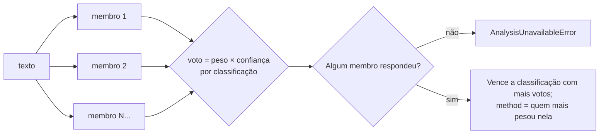
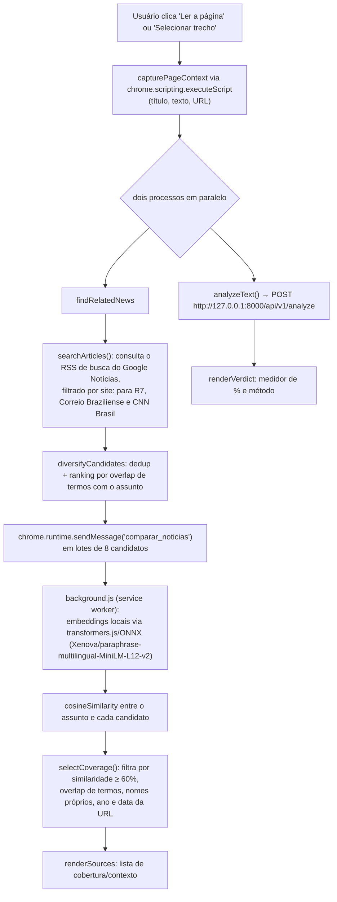
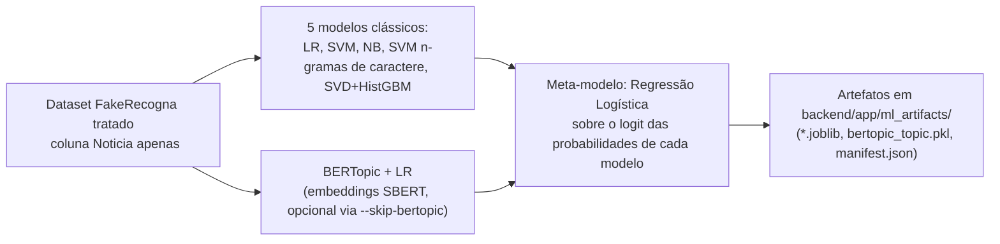
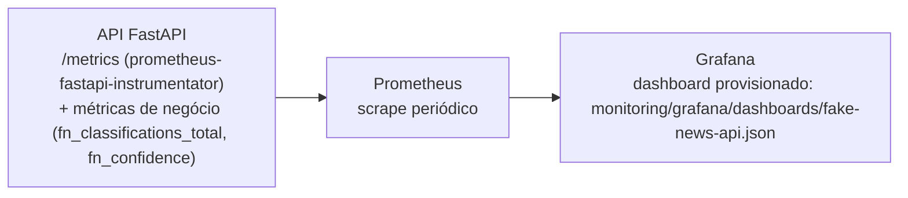
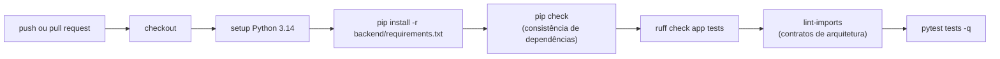

# Fake News Residência

Extensão de navegador (Chrome) que ajuda o usuário a avaliar a confiabilidade de textos na web, **sem substituir o pensamento crítico**. O sistema alerta e explica os critérios usados, mas não decreta o que é verdade ou mentira.

> Projeto do desafio **Fake News / Desinformação** da Residência em IA da UnB. Em desenvolvimento.

## Sumário

- [Status](#status)
- [O que o projeto faz](#o-que-o-projeto-faz)
- [Arquitetura do back-end](#arquitetura-do-back-end)
- [Fluxos](#fluxos)
- [Classificadores disponíveis](#classificadores-disponíveis)
- [Estrutura do repositório](#estrutura-do-repositório)
- [Como rodar o back-end](#como-rodar-o-back-end)
- [Como rodar com Docker e observabilidade](#como-rodar-com-docker-e-observabilidade)
- [Configuração](#configuração)
- [Endpoints](#endpoints)
- [Extensão do navegador](#extensão-do-navegador)
- [Modelo de Machine Learning](#modelo-de-machine-learning)
- [Testes e CI](#testes-e-ci)
- [Limitações conhecidas](#limitações-conhecidas)
- [Requisitos e escopo](#requisitos-e-escopo)
- [Princípios](#princípios)
- [Como contribuir](#como-contribuir)
- [Equipe](#equipe)
- [Licença](#licença)

## Status

| Componente | Estado |
|---|---|
| Back-end: estrutura base, `/health`, `/analyze` | disponível |
| Pipeline de análise (trustlist → ML → fallback) | disponível, fallback de IA ainda é um stub (sempre indisponível) |
| Classificador de ML em produção (`FN_CLASSIFIER=stacking`, 5 modelos) | disponível, ver [limitações](#limitações-conhecidas) |
| Classificador alternativo `ml_stacking` (6 modelos + BERTopic) | disponível via opt-in, não empacotado na imagem Docker (ver [limitações](#limitações-conhecidas)) |
| Análise linguística por regras (`linguistico`) | disponível, pesos não calibrados com dados rotulados |
| Observabilidade (Prometheus + Grafana) | disponível via `docker-compose.yml` |
| Análise complementar por IA generativa (fallback real) | a fazer — hoje é `UnavailableFallback`, só devolve erro |
| Extensão: análise via API local + busca de cobertura em outras fontes | disponível para teste |

## O que o projeto faz

Escopo do MVP, conforme os [requisitos](docs/requisitos.md):

- Análise de um trecho selecionado ou do conteúdo principal da página
- Verificação do domínio contra uma trustlist de fontes confiáveis
- Classificação do texto por Machine Learning, com nível de confiança
- Análise complementar por IA quando a confiança do modelo é baixa
- Busca de outras matérias sobre o mesmo assunto em veículos parceiros, comparadas por embeddings locais (sem servidor)
- Classificação em **confiável**, **suspeito** ou **não verificado**
- Exibição do método usado, da confiança e dos critérios da análise
- Tratamento claro de falhas e de conteúdo insuficiente

## Arquitetura do back-end

O back-end segue arquitetura em camadas (hexagonal), imposta por contrato do [`import-linter`](backend/.importlinter) e checada na CI:

```
app.main
  └─ app.api          (router, schemas de request/response, handlers de erro, métricas)
       └─ app.schemas
            └─ app.bootstrap   (catálogo de classificadores, registro/fábrica)
                 └─ app.application | app.adapters
                      └─ app.domain   (regras puras: enums, modelos, erros, trustlist)
```

Regras verificadas automaticamente (`lint-imports`, roda na CI):

- **Regra de dependência entre camadas**: cada camada só pode importar das camadas abaixo dela nessa lista.
- **O domínio não conhece frameworks nem outras camadas**: `app.domain` nunca importa FastAPI, Pydantic, Starlette, nem `app.api`/`app.application`/`app.adapters`/`app.bootstrap`/`app.core`.

Papel de cada módulo:

| Módulo | Responsabilidade |
|---|---|
| `app/domain/` | Enums (`Classification`, `Method`, `IndicatorCode`), modelos (`AnalysisInput`, `AnalysisResult`, `ClassifierResult`), erros (`TextTooShortError`, `AnalysisUnavailableError`), a porta `Classifier` (Protocol) e a lógica de trustlist. Zero dependência de framework. |
| `app/application/pipeline.py` | `AnalysisPipeline.analyze()`: orquestra trustlist → classificador → fallback. É a única regra de negócio do fluxo de análise. |
| `app/adapters/` | Implementações de `Classifier`: `PlaceholderClassifier`, `UnavailableFallback`, `LinguisticClassifier`, `StackingClassifier`, `MLStackingClassifier`, `EnsembleClassifier` (Composite), e `ResilientClassifier` (Decorator de timeout/isolamento de erro). |
| `app/bootstrap/` | `catalog.py` registra cada classificador (nome usado no `.env` → classe); `registry.py` é a fábrica genérica (`build(nome, settings)`), que decide se o resultado some atrás de `ResilientClassifier`. |
| `app/api/` | Router HTTP (`/health`, `/analyze`), conversão schema↔domínio (`mappers.py`), handlers de erro (sempre HTTP 200 com `status: "error"` no corpo, exceto erro inesperado → 500) e métricas de negócio (`metrics.py`). |
| `app/schemas/` | Contratos Pydantic da API (`AnalyzeRequest`, `AnalyzeResponse`, códigos de erro). |
| `app/core/config.py` | `Settings` (Pydantic Settings), lê variáveis `FN_*` de `.env`. |

## Fluxos

### Fluxo principal: `POST /api/v1/analyze`

Este é o fluxo real implementado em `app/application/pipeline.py::AnalysisPipeline.analyze`:

```mermaid
flowchart TD
    A[Requisição: texto + URL] --> B{len(texto.strip) menor que FN_MIN_TEXT_LENGTH?}
    B -- sim --> E1["TextTooShortError → HTTP 200, status=error,\ncode=texto_insuficiente"]
    B -- não --> C{URL bate com alguma FN_TRUSTED_DOMAINS?}
    C -- sim --> C2[indicators += TRUSTED_DOMAIN]
    C -- não --> D
    C2 --> D[classifier.classify texto]
    D --> D1{AnalysisUnavailableError?}
    D1 -- sim --> D2[ml = None]
    D1 -- não --> D3[ml = resultado do classificador]
    D2 --> F
    D3 --> F{ml existe e ml.confidence maior ou igual a FN_MIN_CONFIDENCE?}
    F -- sim --> R1["Retorna: classification/method/justifications do classificador\n+ indicators (trustlist, se houver)"]
    F -- não --> G[fallback.classify texto]
    G --> G1{AnalysisUnavailableError?}
    G1 -- sim --> G2{ml era None também?}
    G2 -- sim --> E2["Relança AnalysisUnavailableError → HTTP 200, status=error,\ncode=analise_indisponivel"]
    G2 -- não --> R2["Retorna classification=nao_verificado,\nconfidence/method do ml, justificativa fixa"]
    G1 -- não --> R3["Retorna resultado do fallback,\nmethod=ai_fallback"]
```

Pontos importantes desse fluxo, confirmados pelos testes (`backend/tests/test_pipeline.py`):

- **A trustlist nunca decide a classificação por si só.** Ela só adiciona o indicador `trusted_domain` na resposta; o classificador roda sempre, independentemente do domínio. (O diagrama de versões antigas deste README sugeria um atalho "domínio confiável → resultado direto", que **não existe** no código atual.)
- **Confiança exatamente igual ao mínimo conta como suficiente** (`>=`, não `>`).
- **Falha do classificador principal não quebra a API**: vira fallback. Falha dos dois mecanismos é que vira erro (RF21/RF22).
- **Texto insuficiente nunca chega a chamar nenhum classificador** — é validado antes de tudo.
- Qualquer outra exceção não prevista cai no handler genérico (`app/api/error_handlers.py`) e responde HTTP 500 com `code=erro_interno`, sem nunca logar o texto analisado (RNF04/RNF14).

Cada classificador registrado no catálogo (exceto `combinado`) é automaticamente envolvido por `ResilientClassifier`, que roda a inferência numa thread com timeout (`FN_CLASSIFIER_TIMEOUT_SECONDS`, padrão 5s) e converte timeout ou qualquer exceção em `AnalysisUnavailableError` — por isso o pipeline nunca precisa saber se um classificador individual está lento ou quebrado.

### Fluxo do classificador combinado (`FN_CLASSIFIER=combinado`)



Membro indisponível simplesmente não vota; se todos falharem, o conjunto inteiro fica indisponível e o pipeline segue para o fallback.

### Fluxo da extensão (popup → backend + busca de cobertura)



Características relevantes desse fluxo:

- **Nenhum texto sai do navegador** além do necessário para o `/analyze` no backend local e para a busca RSS pública do Google Notícias (que não recebe o conteúdo da notícia, só termos extraídos do título/assunto).
- A comparação de similaridade roda **inteiramente no `service worker` da extensão**, com um modelo ONNX baixado uma vez (via `transformers.js`) — não há chamada a nenhum servidor de IA externo para essa etapa.
- A lista de veículos parceiros é fixa em `extension/shared/news-search.js::PUBLISHERS` (hoje: R7, Correio Braziliense, CNN Brasil) e o veículo da própria notícia é excluído da busca.
- Análise do backend e busca de cobertura rodam em paralelo e falham de forma independente: se o backend cair, a extensão ainda mostra a cobertura encontrada (e vice-versa).

### Fluxo de treino do modelo (`ml/treinar_e_exportar_stacking.py`)



Esse script não é executado pelo backend em runtime — só gera os artefatos que `MLStackingClassifier` carrega. Detalhes de protocolo, métricas por modelo e a decisão final ficam em [`ml/README.md`](ml/README.md).

### Fluxo de observabilidade



As métricas de negócio (`app/api/v1/metrics.py`) só contam respostas com `status=ok`; respostas de erro não entram na contagem, para não distorcer a distribuição real de classificações.

### Fluxo de CI



Qualquer etapa falhando interrompe o workflow (ver [`.github/workflows/ci.yml`](.github/workflows/ci.yml)); não há etapa de CI para a extensão (os testes de `extension/tests/` com `node --test` são manuais).

## Classificadores disponíveis

Registrados em `app/bootstrap/catalog.py`, selecionáveis via `FN_CLASSIFIER` (classificador principal) ou `FN_FALLBACK_METHOD` (fallback), e como membros de `FN_ENSEMBLE_MEMBERS` quando `FN_CLASSIFIER=combinado`:

| Nome no `.env` | Classe | O que faz | Precisa de artefato? |
|---|---|---|---|
| `placeholder` | `PlaceholderClassifier` | Nunca classifica de verdade; sempre devolve `nao_verificado` com confiança 0. Serve para o pipeline funcionar sem modelo. | não |
| `stacking` | `StackingClassifier` | **Padrão de produção.** Stacking de 5 modelos clássicos sobre um único artefato empacotado. | `backend/models/stacking.joblib` (incluído no repo) |
| `ml_stacking` | `MLStackingClassifier` | Stacking de 6 modelos (os 5 clássicos + BERTopic), decisão original do time de dados (RF10). Opt-in. | artefatos em `backend/app/ml_artifacts/` + download do modelo de embeddings SBERT na primeira execução |
| `linguistico` | `LinguisticClassifier` | Heurística por palavras-chave/pontuação/caixa alta. Não usa modelo treinado; nunca classifica como `confiavel` (ausência de indício não é evidência). | não |
| `ai_fallback` | `UnavailableFallback` | Placeholder do RF11: sempre levanta `AnalysisUnavailableError`. Ainda não existe análise complementar por IA generativa real. | não |
| `combinado` | `EnsembleClassifier` | Composite: combina os membros de `FN_ENSEMBLE_MEMBERS` por voto ponderado (peso × confiança). | depende dos membros escolhidos |

Um nome desconhecido em `FN_CLASSIFIER`/`FN_FALLBACK_METHOD` é erro de configuração e falha na inicialização (fail fast). Já uma falha ao **carregar** o classificador (artefato ausente, dependência faltando) não derruba a API: o classificador vira `UnavailableClassifier` e o pipeline segue normalmente para o fallback (RNF09).

## Estrutura do repositório

```
.
├── backend/          API em Python (FastAPI) — ver Arquitetura do back-end
│   ├── app/
│   │   ├── domain/        regras puras (enums, modelos, erros, trustlist)
│   │   ├── application/   AnalysisPipeline
│   │   ├── adapters/       classificadores e o decorator de resiliência
│   │   ├── bootstrap/      catálogo e fábrica de classificadores
│   │   ├── api/             router, schemas↔domínio, erros, métricas
│   │   ├── schemas/         contratos Pydantic da API
│   │   ├── core/            configuração (.env)
│   │   └── ml_artifacts/     artefatos do classificador ml_stacking (6 modelos)
│   ├── models/             artefato do classificador stacking (padrão, 5 modelos)
│   └── tests/
├── extension/         Extensão do navegador (Manifest V3)
│   ├── popup/              UI do popup
│   ├── background.js       service worker: embeddings locais (transformers.js/ONNX)
│   ├── shared/              captura de página, chamada à API, busca de cobertura
│   └── tests/               testes com node --test
├── ml/                Treino e exportação do modelo de Machine Learning
├── monitoring/        Provisionamento de Prometheus e Grafana
├── docs/              Requisitos funcionais/não funcionais
└── .github/           Workflow de CI, templates de issue e de PR
```

## Como rodar o back-end

O modelo foi treinado com Python 3.14 e scikit-learn 1.9.1. Para reproduzir a
inferência local, use a mesma versão principal/secundária do Python e as versões
fixadas em `backend/requirements.txt`.

Requisitos: Python 3.14 e venv. O artefato `backend/models/stacking.joblib` é
necessário para iniciar o classificador padrão; ele é incluído neste repositório.

```bash
git clone https://github.com/Withy-S/Fake_News_Residencia.git
cd Fake_News_Residencia/backend

python3 -m venv .venv
source .venv/bin/activate        # Windows: .venv\Scripts\activate
pip install -r requirements.txt

cp .env.example .env
uvicorn app.main:app --reload
```

A documentação interativa da API fica em http://127.0.0.1:8000/docs.

Para testar a extensão, em `chrome://extensions` ative o modo do desenvolvedor e
carregue `extension/` como extensão descompactada. Mantenha o backend rodando em
`http://127.0.0.1:8000`, abra uma notícia e use um dos modos de análise. O popup
mostra a probabilidade estimada pelo stacking; ela não é uma verificação factual.
Se o Chrome bloquear a requisição por CORS, copie o ID da extensão da página de
extensões e configure `FN_ALLOWED_ORIGINS=["chrome-extension://ID_DA_EXTENSAO"]`
em `backend/.env`, depois reinicie a API.

## Como rodar com Docker e observabilidade

```bash
cp .env.example .env   # na raiz, se existir; ajuste GRAFANA_ADMIN_PASSWORD se quiser
docker compose up --build
```

Isso sobe três serviços:

| Serviço | Porta local | O que é |
|---|---|---|
| `api` | `127.0.0.1:8000` | o backend (usa `backend/.env`) |
| `prometheus` | `127.0.0.1:9090` | coleta `/metrics` da API periodicamente |
| `grafana` | `127.0.0.1:3000` | dashboard pré-provisionado (usuário `admin`, senha em `GRAFANA_ADMIN_PASSWORD`, padrão `admin`) |

A imagem Docker da API (`backend/Dockerfile`) copia apenas `app/` e `models/` — **não inclui `app/ml_artifacts/`**, então o classificador `ml_stacking` (6 modelos) não funciona dentro do container; use o padrão `stacking` em produção/Docker (ver [limitações](#limitações-conhecidas)).

## Configuração

Os parâmetros ficam em variáveis de ambiente (arquivo `backend/.env`, criado a partir do `.env.example`). O `.env` nunca vai para o Git.

| Variável | Campo em `Settings` | Descrição | Padrão |
|---|---|---|---|
| `FN_MIN_TEXT_LENGTH` | `min_text_length` | Tamanho mínimo (em caracteres, após `strip()`) do texto para análise | `20` |
| `FN_MIN_CONFIDENCE` | `min_confidence` | Confiança mínima (`>=`) do classificador principal antes de acionar o fallback | `0.6` |
| `FN_CLASSIFIER` | `classifier` | Classificador principal, ver [tabela acima](#classificadores-disponíveis) | `stacking` |
| `FN_STACKING_MODEL_PATH` | `stacking_model_path` | Caminho do artefato usado pelo classificador `stacking` | `models/stacking.joblib` |
| `FN_FALLBACK_METHOD` | `fallback_method` | Classificador usado como fallback quando a confiança do principal é baixa | `ai_fallback` |
| `FN_ENSEMBLE_MEMBERS` | `ensemble_members` | Lista JSON de nomes de classificadores membros, só usada quando `FN_CLASSIFIER=combinado` | `[]` |
| `FN_ENSEMBLE_WEIGHTS` | `ensemble_weights` | Dicionário JSON `{nome: peso}` para os membros do `combinado`; membro sem peso usa `1.0` | `{}` |
| `FN_TRUSTED_DOMAINS` | `trusted_domains` | Trustlist de domínios (e subdomínios), em JSON | `[]` |
| `FN_CLASSIFIER_TIMEOUT_SECONDS` | `classifier_timeout_seconds` | Timeout (segundos) de cada classificador individual, aplicado por `ResilientClassifier` | `5.0` |
| `FN_REQUEST_TIMEOUT_SECONDS` | `request_timeout_seconds` | **Lido, mas hoje não é consumido em nenhum lugar do código** (campo reservado) | `10.0` |
| `FN_ALLOWED_ORIGINS` | `allowed_origins` | Origens permitidas (CORS), em JSON — precisa incluir `chrome-extension://ID_DA_EXTENSAO` para a extensão funcionar | `[]` |

Os valores padrão são provisórios e podem mudar conforme as decisões do grupo.

## Endpoints

| Método | Rota | Estado |
|---|---|---|
| GET | `/api/v1/health` | disponível — sempre `{"status": "ok"}` |
| POST | `/api/v1/analyze` | disponível |
| GET | `/metrics` | disponível — formato Prometheus |

### `POST /api/v1/analyze`

**Requisição** (`AnalyzeRequest`):

```json
{
  "analysis_type": "selecao",
  "text": "texto a analisar, até 20000 caracteres",
  "title": "opcional, até 500 caracteres",
  "url": "https://exemplo.com/noticia"
}
```

`analysis_type` é `"selecao"` (RF02) ou `"pagina_completa"` (RF03). O campo `domain`, se enviado, é **ignorado de propósito** — quem o define é o backend a partir da `url`, nunca o cliente (poderia ser forjado).

**Resposta de sucesso** (`status: "ok"`):

```json
{
  "status": "ok",
  "classification": "suspeito",
  "confidence": 0.87,
  "fake_probability": 0.87,
  "method": "ml_model",
  "justifications": ["..."],
  "indicators": [{"code": "trusted_domain", "description": "..."}],
  "sources": [],
  "disclaimer": "Classificação automática, sujeita a erros. Não é uma verificação de fatos: pesquise em fontes confiáveis."
}
```

- `classification`: `confiavel` | `suspeito` | `nao_verificado`.
- `method`: `ml_model` | `ai_fallback` | `analise_linguistica` | `whitelist` (este último está definido no enum mas **nenhum fluxo atual o produz** — a trustlist nunca substitui o classificador, só gera um indicador).
- `sources` e o schema `Indicator`/`Source` existem no contrato (RF09/RF19/RF20, V2), mas a API hoje nunca popula `sources` — isso é feito pela extensão, no cliente, não no backend.

**Resposta de erro** (`status: "error"`, sempre HTTP 200 exceto erro inesperado):

```json
{"status": "error", "error": {"code": "texto_insuficiente", "message": "..."}}
```

| `error.code` | Quando acontece | HTTP |
|---|---|---|
| `texto_insuficiente` | Texto menor que `FN_MIN_TEXT_LENGTH` após `strip()` | 200 |
| `analise_indisponivel` | Classificador principal **e** fallback indisponíveis | 200 |
| `erro_interno` | Qualquer exceção não tratada (nunca loga o texto analisado) | 500 |

HTTP 200 nos dois primeiros casos é decisão deliberada do grupo: o erro viaja no corpo via `status`, não no código HTTP.

## Extensão do navegador

Manifest V3, sem servidor próprio — fala direto com o backend local (`http://127.0.0.1:8000`) e com o RSS público do Google Notícias.

| Arquivo | Papel |
|---|---|
| `popup/popup.js` | Estado da UI: tela inicial → tela de resultado, medidor de % de "chance de fake", lista de cobertura. |
| `shared/page-context.js` | `capturePageContext`/`captureActiveTab`: extrai título e texto (seleção ou conteúdo principal da página) via `chrome.scripting.executeScript`. |
| `shared/api.js` | `analyzeText` (chama o backend) e `findRelatedNews` (orquestra a busca de cobertura). |
| `shared/news-search.js` | Monta queries a partir do título/assunto, consulta o RSS de busca do Google Notícias por veículo parceiro, deduplica e filtra a cobertura final por similaridade/termos/data. |
| `background.js` | Service worker: carrega o modelo de embeddings local (`transformers.js` + ONNX, `Xenova/paraphrase-multilingual-MiniLM-L12-v2`) e calcula similaridade de cosseno — a única parte do fluxo de busca que não é uma chamada de rede. |

Veículos parceiros de cobertura hoje: **R7, Correio Braziliense e CNN Brasil** (lista fixa em `news-search.js::PUBLISHERS`); o próprio veículo da notícia analisada é excluído da busca.

Testes da extensão (`node --test`, não fazem parte da CI ainda):

```bash
cd extension
node --test tests/
```

## Modelo de Machine Learning

Ver [`ml/README.md`](ml/README.md) para o protocolo completo de treino, as métricas por modelo e a decisão do time de dados. Resumo:

- Dataset: FakeRecogna tratado (não vai para o git), usando **somente a coluna `Noticia`** — a coluna `Titulo` tem vazamento de rótulo em ~64% dos casos Fake.
- Modelo final decidido (protocolo com validação cruzada de 5 folds, IC95% por bootstrap): **stacking com meta-modelo de regressão logística**, ROC-AUC 0.994, Brier 0.027 — supera todos os 6 modelos individuais com ganho consistente.
- O artefato de produção (`backend/models/stacking.joblib`, usado pelo classificador `stacking`) empacota os 5 modelos clássicos; o artefato completo de 6 modelos com BERTopic fica em `backend/app/ml_artifacts/` (classificador `ml_stacking`, opt-in).

## Testes e CI

Rodar sempre de dentro de `backend/`:

```bash
pytest -q
ruff check . && ruff format .
lint-imports
```

A CI (`.github/workflows/ci.yml`) roda, nessa ordem, a cada push/PR: instalação das dependências, `pip check`, `ruff check`, `lint-imports` e `pytest`. Qualquer falha bloqueia o merge.

## Limitações conhecidas

- **Pré-processamento do texto para o `ml_stacking`**: a coluna `Noticia` do dataset de treino já vem lematizada de forma não padrão (ex.: "saúde" → "saudar"). O `MLStackingClassifier` recebe o texto da extensão sem essa transformação, o que gera classificações pouco confiáveis para texto real da web — a API já avisa isso em `justifications`. Detalhes em [`ml/README.md`](ml/README.md). O classificador `stacking` (padrão) tem a mesma limitação, documentada nos seus próprios testes de regressão.
- **`ml_stacking` não funciona dentro do container Docker**: o `Dockerfile` não copia `app/ml_artifacts/`; usar esse classificador exige rodar fora do Docker ou ajustar a imagem.
- **Fallback de IA ainda não existe**: `ai_fallback` é um stub que sempre devolve indisponível (RF11 pendente).
- **`FN_REQUEST_TIMEOUT_SECONDS` não é consumido** em nenhum ponto do código atual.
- **`Method.WHITELIST` nunca é produzido** pelo pipeline atual; a trustlist é só um indicador complementar.
- **Busca de cobertura restrita a 3 veículos** fixos no código da extensão, via RSS público do Google Notícias (sujeito a instabilidade/bloqueio do serviço de terceiros).

## Requisitos e escopo

Os requisitos funcionais e não funcionais estão em [`docs/requisitos.md`](docs/requisitos.md), com prioridade **MVP**, **V2** ou **Futuro**. Ficam para V2, entre outros: análise de imagens, recomendação de fontes no backend, histórico local e feedback do usuário.

## Princípios

- As classificações são **estimativas automáticas**, sujeitas a erros, e não determinações de verdade.
- Coletar e transmitir apenas os dados necessários para a análise.
- Segredos e chaves nunca ficam no código-fonte.

## Como contribuir

1. Crie uma branch a partir da `main`: `feat/nome`, `fix/nome` ou `docs/nome`.
2. Use [Conventional Commits](https://www.conventionalcommits.org/pt-br/v1.0.0/): `feat:`, `fix:`, `docs:`, `test:`, `chore:`.
3. Rode `pytest -q`, `ruff check .` e `lint-imports` antes de abrir o PR.
4. Prefira PRs pequenos e peça revisão a pelo menos uma pessoa do grupo.

## Equipe

Davi
Mayara
Miti
Tayrine
Rafaella
Rayssa

## Licença

A definir.
